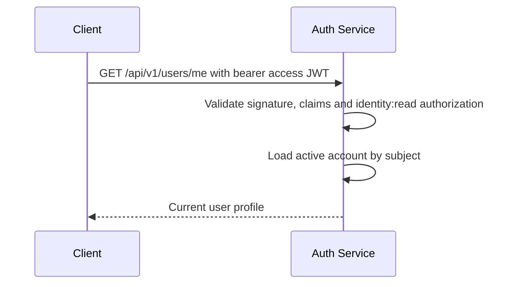
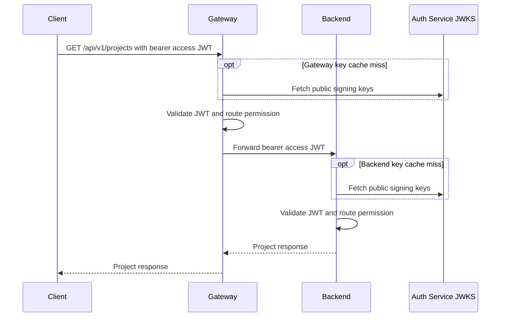

# JWT bearer authentication

Send an access JWT in the `Authorization: Bearer <access_token>` header. The access JWT has an RS256 signature, stable user UUID in `sub`, Auth Service `iss`, API `aud`, expiration, scopes, roles and permissions. Resource Servers validate the signature, issuer, audience, expiry, optional `nbf` and the access-token marker before mapping authorities. The ID token authenticates the user to the OIDC client.

Set each consumer's public `AUTH_ISSUER` and `AUTH_AUDIENCE` to the exact issuance values. `AUTH_JWKS_URI` can point to an internal HTTPS or otherwise trusted JWKS endpoint. Spring caches the keys and refreshes when needed. Unauthenticated or invalid tokens receive 401. Valid tokens without the operation's scope, role or permission receive 403.

The offline checks deliberately use a five-minute default access lifetime. Revocation and introspection affect central token state immediately. Previously issued JWTs presented to offline validators can still be accepted until expiration and allowed clock skew.
