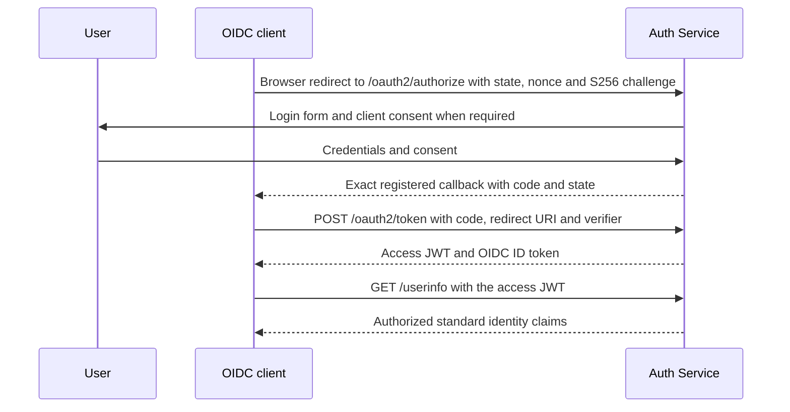

# Authorization Code with PKCE and OIDC

Use an OIDC client library. For each login, generate independent random state, nonce and a 43–128 character PKCE verifier. Supply the verifier's base64url-encoded SHA-256 digest as the challenge with `code_challenge_method=S256`. Verify state on the callback and validate the ID token, including nonce, issuer and client audience.



Use `openid` to request OIDC. Add `profile` for `preferred_username`, `email` for email claims and the exact API scopes required by the client. Public browser and mobile clients use `client_id` and PKCE. Confidential web backends additionally authenticate with HTTP Basic and may receive rotating refresh tokens. Spring Authorization Server supplies authorization code generation, validation and consumption, token exchange, OIDC discovery, consent and introspection.

## Client provisioning

Set `auth.clients` in an external Spring YAML file or construct the list with environment properties such as `AUTH_CLIENTS_0_ID`. Restart the Auth Service to provision or update client records. Changing a client configuration clears that client's stored grants and consent. Per-client keys follow this format.

```yaml
auth:
  clients:
    - id: web
      redirect-uris: [https://app.example.com/oidc/callback]
      post-logout-redirect-uris: [https://app.example.com/]
      scopes: [openid, profile, email, 'identity:read', 'project:read']
      consent: true
    - id: web-backend
      secret-hash: ${WEB_BACKEND_CLIENT_SECRET_HASH}
      redirect-uris: [https://bff.example.com/oidc/callback]
      scopes: [openid, 'identity:read', 'deployment:read']
      consent: true
```

Generate a high-entropy secret for a confidential client. Supply its `{bcrypt}`-prefixed BCrypt hash, cost 12–16, to the Auth Service from a secret store. Deliver the raw secret to the confidential backend via its own secret store. For mobile apps, use an app-claimed HTTPS redirect. Development also supports exact HTTP localhost and loopback redirects.

Remove retired clients from provisioning configuration before removing their records by `client_id` in `oauth2_registered_client`. Foreign keys delete associated OAuth grants and consent. Existing locally validated access JWTs retain their remaining lifetime. Coordinate policy changes across replicas and use the same client configuration on each instance.
